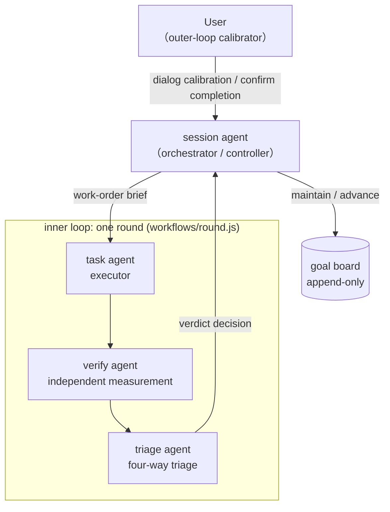
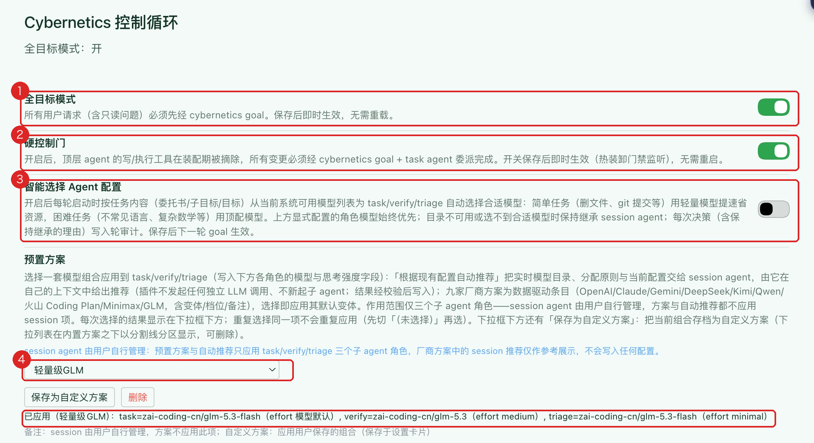
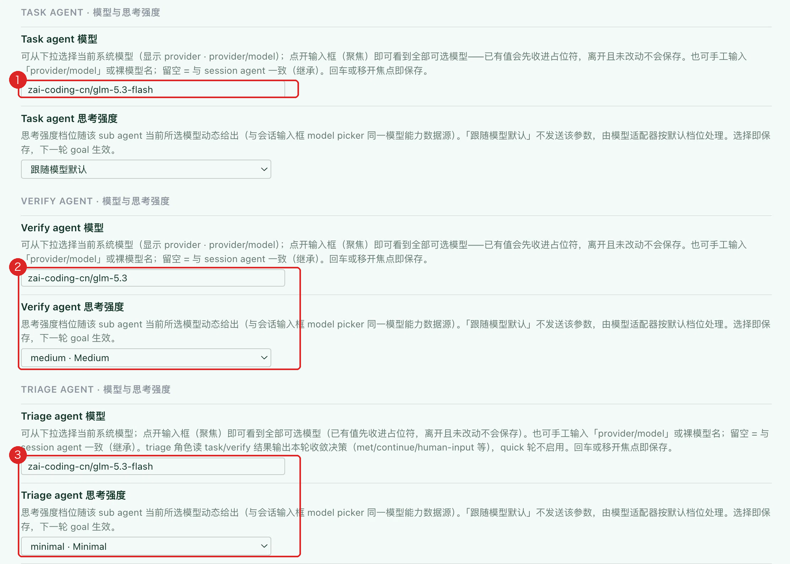
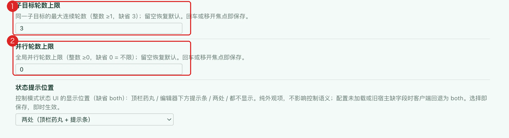
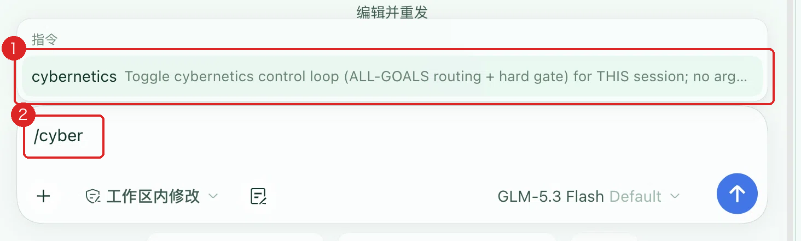
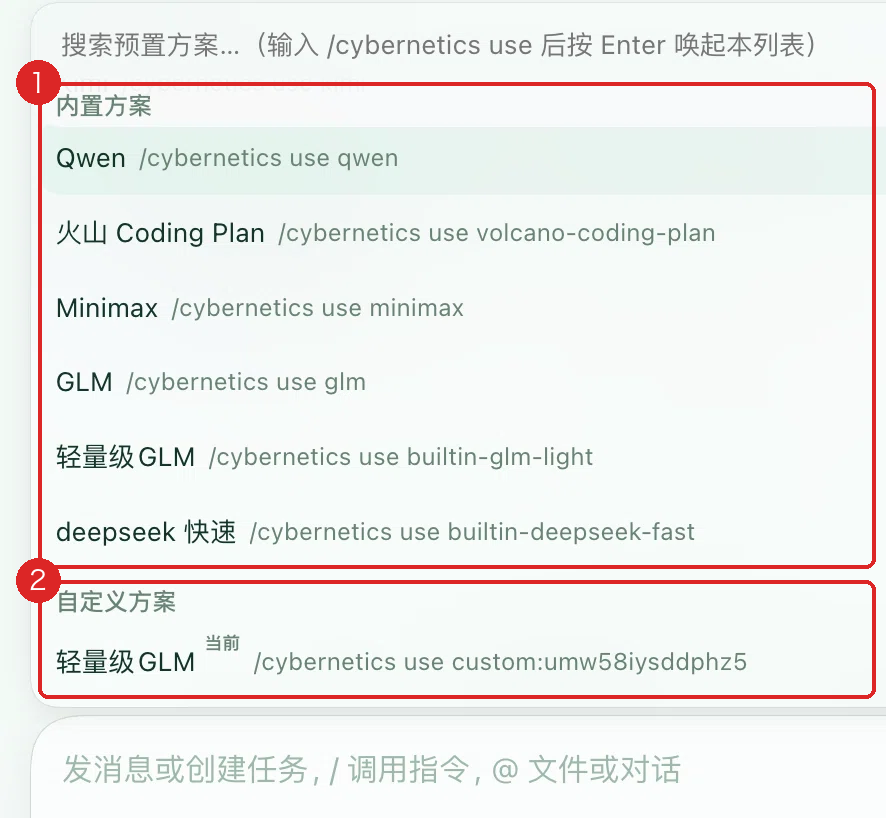
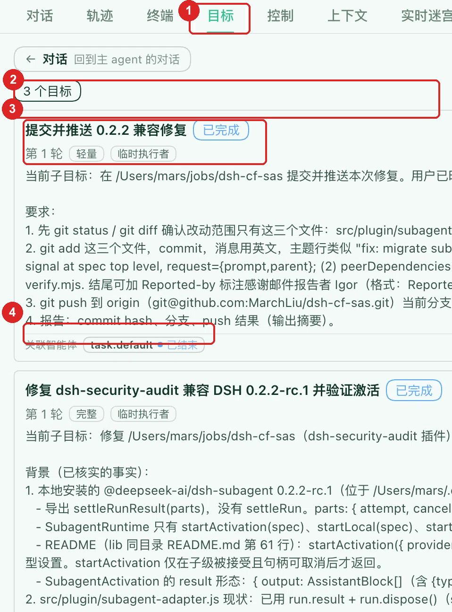

## 动机和背景

上一篇博客，我介绍了 Cybernetics 的理论基础。但是最初 DSH Cybernetics 并不单纯是因为要建立控制论系统而开发的。相反，我首要的驱动力是，想要解决一些体验问题。

开始一个任务时，通常我习惯写一个尽可能详尽的文档。即使如此，我还是很少会一次性就完成任务。任务过程中，随着新的反馈出现，我会想起还没有没有覆盖的边界条件；AI交付的结果，可能会引出新的问题；我需要验收结果，提醒AI哪些结果偏移了目标。

尽管现代的 LLM 服务越来越重视 cache，但是，随着一个会话的延续，越来越长的对话历史总归是带来了更大的性能负担，以及注意力衰退的风险。并且，随着我在对话中提出新的目标，整个会话历史实际上变成了一条有向树。

这带来一个问题，如果我将完整的对话都发给AI，其中不在当前目标方向的内容，浪费了有限的 context 长度。

这并非我一个人的感受，DSH和ChatGPT都支持会话分叉，这个功能就是为了允许用户为不同的任务走向提供干净的context。

这也就引发了新的挑战，如果不同的 Agent 之间还需要再次合并context呢？为此 dsh 提供了通过 at 指定会话的能力。这个能力很好用，结合我开发的 dsh-graft，可以方便的在不同会话间传递消息。

但是这也要求用户先有了管理分叉的决策，才能保持会话信息干净。我个人而言，多次遇到在消息发出后，才注意到这应该是一个不同的分支。

如果会话变得很长，回顾我在会话中说过什么，本身就成为了负担。

当我中途有了新的想法时，DSH会给我两个选择，停止当前的任务，回应我新的输入，或者将新的输入派在既有任务的后面。这个功能很方便，但是我很贪心，我希望它更近一步。

于是我开始考虑，是否可以改进复杂会话的管理

- 每个具体的行动，只关心行动本身的目标，它不需要得到完整的会话内容
- Agent应该能够自动的编写 goal，目标的内容来自整个对话历史，而不是简单的把最近的用户输入当作 goal。
- 对话是双工的，我有了新的想法，agent自动判断，是否要中断某个在运行的任务，是否要开新的并行任务，并且要允许一个会话有多个在运行的 goal

## 实现思路

我将会话分解为 session agent 和 task agent 两层。

- session agent是人和agent交互的外环，它是双工的，几乎不会被阻塞，因为它只负责思考和制定目标
- task agent是内环的行动智能体，每个task agent只关注自己的goal，并不关心其它的行动，因此它的context playload 总是 O(n) 的
- 近一步的，AI 帮我将 task agent 分解为了三类，用于实现目标的仍然叫task agent，近一步的提供用于验证的verify agent和收尾，决策后续行动的 triage agent，这也就是 cybernetics 项目文档上的基本架构阐述

也就是说，实际上并不是我先有了控制理论，然后依据理论去设计这个插件，而是在设计这个插件的过程中，发现这个过程其实契合了控制论的基本要素。

## 实际体验与改进

上周我的重点在改进其配置和使用过程，同时，也尽可能的使用 dsh-cybernetics 进行工作。这个过程中，我有了很多预料之外的体验。

当我不需要再关注会话长度的影响后，很多会话走到了非常长的程度。一个会话包含十几个相关的目标也完全可能。与 DSH 官方最近提出的 [super agent](https://mp.weixin.qq.com/s/zoS7GlReWPhfCjENGxXCdg) 相比，dsh cybernetics 的控制组件负担了更多的思考，不仅仅是简单的任务转发，而内环的任务角色和目标更为紧凑。

我上周为 cybernetics 开发了配置页，允许用户为task agent、verify agent和traige agent设定不同的模型。

在这个过程中，我问了使用过的几家AI，让它们自己给出自己生态的模型组合，并且把这些配置作为预置的方案写入了插件里。使用了其中几家模型的组合以后，我发现其中的问题比较明显

- 按照控制理论，甚至按照传统的软件工程的视角，规划和验证的角色，应该分配最多的资源，但是日常很多任务，其实是不需要过度的验证，我有一次git commit，看到verify agent花了很长的时间逐字节验证是否可靠的提交了所有的内容。这显然是完全不必要的，这导致消耗的时间远远超出了必要
- 过重的配置方案带来了经济性问题，我的工作强度没有增加，但是上周我出现了很多次耗光所有订阅的5小时额度的情况，甚至有一个账号的周额度也用光了
- 实际上我日常使用的通常是各种模型的默认推理强度，足够完成任务，过高的推理强度对性能影响明显

因此我在项目中添加了两个轻量级配置，一个完全基于deepseek 4 flash，一个完全基于 GLM flash。实际上这才是我现在用的最多的两个方案。大部分情况下，我的开发任务完全可以通过清晰的定义一次达成任务，我完全可以选择更快，更轻量的配置。从我几天的工作情况看，我使用的tokens比上周最多的时候，只有1/10不到。

类似简单的编写邮件、撰写 commit 信息，都是高度模式化的工作，甚至一些简单的任务，分解跟踪的意义不大——例如一组复杂的任务commit后，我仅需要一次git push。此时关掉 cybernetics，普通模式下运行就足够了。

还有一些任务，没有必要用思考能力很强的模型担任 session agent，就我的经验，glm flash 和 deepseek flash 的默认强度，足够完成普通的编程任务。

有时候我们也需要使用不同的模型应对不同类型的任务，例如 openai 生态比 anthropic 生态更擅长文档编写。我还遇到过过同样一个人的两张照片，只有gemini能够正常识别的情况。

因此，我添加了用户自定义配置的管理能力。用户可以配置自己的多个不同方案，用于不同的任务。

对我们这些普通用户，可以把最强的模型和最高的推理强度，用在真正复杂的任务中。

为了能够快速的切换调度策略，我做了几个功能
- `智能选择 Agent 配置` ，这个选项允许 Session Agent 配置 sub agent时，使用配置方案之外的模型配置，这样，如果Session Agent认为当前配置和任务难度不匹配时，能够灵活的切换
- `cybernetics 命令`，允许用户在编辑器中直接开关 cybernetics 工作模式，或者通过 `use` 子命令切换不同的配置方案。输入 `/cybernetics use` 后 enter，会显示可用的方案列表，这样我们不需要进入 cybernetics的配置页，就可以切换工作状态

## Cybernetics 视图

DSH Cybernetics 的重要目标之一，是提高复杂任务的可解释性。因此，我在对话页中添加了一个目标页签，它列出了会话出现过的所有 goal。每一个 goal，代表对应的一个任务循环。这些循环或许顺利的依次完成，也有可能因为某种原因被阻塞或者中止，在这个列表上，一目了然，并且方便的跳转到会话的每一个agent。这个路线清晰的给出了会话的目标脉络，为我跟踪工作状态提供了很大的便利。

实际上系统还添加了一个控制页，最初的想法是为目标网络建立不同的跟踪视角。但是我更习惯使用目标视图，或许在后续的版本中，我会去掉控制视图，或者将它变成目标视图的另一种形态。
